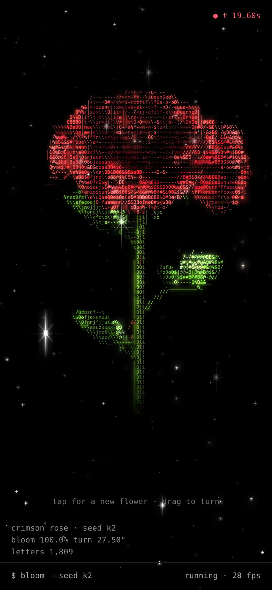

# ascii bloom

A generative ASCII flower that grows, blooms and turns under a field of stars.
Every run grows a new flower. The species, petal shapes, colors, stem curve, leaves and sky all change.



## Run it

Open `index.html` in a browser. There's no build step and nothing to install.

To host it with GitHub Pages, go to **Settings → Pages**, set the source to the `main` branch and the root folder, and open the link it gives you.

## Controls

| Input | Action |
| --- | --- |
| Tap / click, `Space`, `R` | Grow a new flower |
| Drag, `←` `→` | Turn the flower |
| `P` | Pause |
| `G` | Glow on/off |
| `H` | Hide the HUD |
| `S` | Save a PNG |
| `[` `]` | Less or more detail |

## Seeds

Each flower comes from a seed. The current seed appears in the HUD and in the URL, so you can share a flower.

```
index.html?seed=k2        a crimson rose
index.html?seed=k26       a coral peony
index.html?seed=k17&t=12  jump to 12 seconds in
```

Extra URL options are `hud=0` and `glow=0`.

## What it can grow

| Species | What changes from seed to seed |
| --- | --- |
| Rose | 6 to 9 spiral layers, curled-back outer petals, a tight center, thorns, compound serrated leaves |
| Tulip | Cup or lily-flowered pointed tips, long blade leaves from the base |
| Lily | 6 recurved tepals, speckles, long stamens with anthers, a pistil |
| Daisy | 14 to 28 ray petals in 1 or 2 rows, notched or fringed tips, a domed disk of florets |
| Dahlia | 8 to 12 rows of quilled petals, spiky or pompon form |
| Peony | 9 to 13 ruffled layers, sometimes with a stamen ring |
| Lotus | Boat-shaped pointed petals, a seed pod, round pad leaves |
| Anemone / camellia | Broad petals with a dark disk and stamen ring, or a gold stamen tuft |

Colors come from 16 palette families (crimson, sunset, picotee, stargazer and more), each with a random hue shift.

## How it works

1. **Genome** : a seeded RNG builds a description of the plant. This covers the species, petal layers (count, length, width, opening angles, cup, curl, ruffle, tip shape, timing), centers, sepals, leaves, the stem curve, head tilt and the sky.
2. **Geometry** : on every frame each petal is rebuilt as a parametric surface. The spine is integrated from an angle profile that blends between the closed bud and the open flower, so blooming is a real shape change and not a scale. Leaves, stem (a Bézier tube), stamens and disks are made the same way.
3. **Rendering** : surface points are projected into a character grid with a z-buffer. Lit surfaces get letters from a density ramp. Petal rims and silhouettes get `/ \ | _ -` based on the edge direction on screen. A two-pass downscaled copy of the frame adds the glow.
4. **Timeline** : faint `+` dust marks where the plant will appear, and a drawing light climbs the stem with sparks. Leaves unfold, the bud closes in, petals open outer layers first, and then the flower turns and breathes while pollen drifts and the odd petal falls.

## License

MIT
